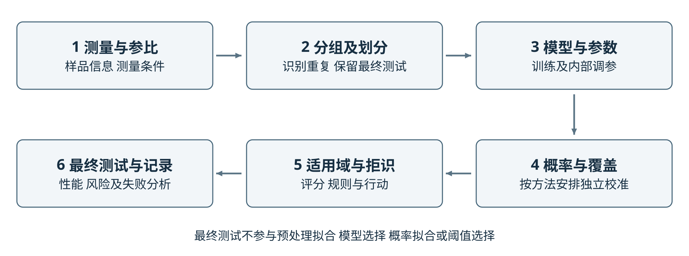
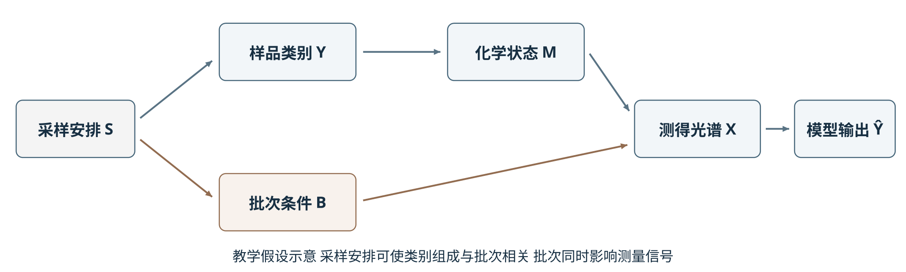

# 第15章 可信智能分析：不确定度、适用域与因果机制

> 第4篇 跨模态、标准化与可信智能分析

## 章首导引

预测类别、预测概率、输入支持范围和化学解释回答不同的问题。本章先辨认采样、测量、参比与模型中的不确定度，再讨论概率校准、共形预测、适用域、拒识和因果证据。末尾的公开拉曼教学实验采用280个新RRUFF编号，展示概率有所改善而未知材料仍被大量接受的真实结果。

本章沿用15.1—15.8的原有主题与小节顺序，新增内容来自本组课程论文与可复核计算。交互中的小型演示均标明教学假设；真实结果页仅重算固定输出，不在浏览器训练模型。方法讨论中未实现的共形、物理信息网络与因果实验，不标记为已完成计算。

## 学习目标

- 区分测量不确定度、分类准确率、概率质量、预测覆盖和拒识接受率。
- 说明温度缩放、共形预测及T²/Q评分的数据条件、用途与失效边界。
- 为重复光谱确定独立单位，识别预处理泄漏和完全混杂。
- 从逐样品记录重算概率与拒识指标，回查高置信度错误及参比标签。
- 将归因图、化学机制和对照实验各自能支持的结论写清楚。

## 本章知识图谱



图1给出测量与参比、独立划分、建模、概率评价、适用域及最终记录之间的依赖。箭头表示流程所需证据，不表示前一步完成就保证下一步正确。最终测试不得用于选择预处理、温度或拒识阈值。可编辑SVG与下文数据角色一致。

## 15.1 点预测、区间预测与不确定度来源

先说明被测对象和输出形式，再讨论哪些变化被纳入不确定度。

<section class="interactive-lab ch15-lab" data-ch15-lab="1"></section>

### 15.1.1 采样、测量、标签和模型不确定度

测量不确定度与测量结果相联系，用于表征可合理赋予被测量的量值分散程度<sup><a href="#/resources/annual/2026-2027/references/ch15?id=ref-6">[6]</a></sup>。 在智能分析中，其来源可以沿采样、制样、仪器测量、参考信息和模型处理逐步识别。例如，样品不均匀性影响所取部分的代表性，制样条件和仪器响应影响光谱，参考方法及标签记录影响训练目标，建模样品覆盖与模型设定影响预测。这里列举的是需要调查的误差来源，不能在缺少数据时直接为它们分配数值。

分类概率描述给定输入和模型下的类别输出，不是测量链全部不确定度的汇总。对固定光谱重复运行算法，只能考察计算或模型随机性；它不覆盖重新采样、重新制样及仪器长期变化。即使预测区间由模型给出，也需要说明其针对的是未来观测、模型均值还是其他对象。将这些对象混用，会造成区间含义与分析用途不一致<sup><a href="#/resources/annual/2026-2027/references/ch15?id=ref-5">[5]</a>,<a href="#/resources/annual/2026-2027/references/ch15?id=ref-7">[7]</a></sup>。

误差、偏倚和不确定度也应区别使用。已识别偏倚需要评估并在适当情况下校正，校正本身仍可能有不确定度；不确定度不是一项可以代替偏倚调查的附加量。对参考标签存在疑问的样品，模型与标签不一致也不能立即归因为模型失效，应回查参考方法和记录<sup><a href="#/resources/annual/2026-2027/references/ch15?id=ref-5">[5]</a>,<a href="#/resources/annual/2026-2027/references/ch15?id=ref-6">[6]</a></sup>。

### 15.1.2 偶然不确定度与认知不确定度

机器学习中常用偶然不确定度描述在给定观测条件下仍存在的数据变异，用认知不确定度描述有限知识、数据覆盖或模型设定带来的不足。这种区分需要结合模型与观测条件理解：提高仪器信噪比可能改变原先视为不可约的变异，增加训练数据也不必然消除错误模型结构带来的偏差。

深度集成以多个模型的预测组成集成，是表达模型差异的一种代表方法；预测一致不意味着样品处于适用域内，集成成员也可能共同依赖同一种捷径<sup><a href="#/resources/annual/2026-2027/references/ch15?id=ref-8">[8]</a></sup>。 Ovadia等在多个任务中比较了不确定度方法，发现数据偏移会影响误差和概率质量。该结果说明，不确定度表达还需要在目标条件下检验，不能仅凭方法名称判断可靠性<sup><a href="#/resources/annual/2026-2027/references/ch15?id=ref-4">[4]</a></sup>。

### 15.1.3 点估计、区间和预测分布

点预测便于直接作出类别或数值判断，但不呈现预测范围；概率向量表达模型对各候选类别的分配，预测集合允许保留多个候选标签，回归区间则在连续量尺度上表示可能范围。这些表达适用于不同问题，均需说明构造依据。分类集合很大时，即使覆盖率高，也可能缺少鉴别价值；区间很窄时，若经常遗漏真实结果，也不能称为可靠<sup><a href="#/resources/annual/2026-2027/references/ch15?id=ref-9">[9]</a></sup>。

表1比较本章使用的主要概念。特别需要区分机器学习的分类准确率与计量学中的准确度、正确度和精密度；仅将英文术语直接对应中文，容易掩盖评价对象的不同。

表1 可信分析中主要概念的评价对象

| 概念 | 评价对象 | 不能单独推出的结论 |
|---|---|---|
| 分类准确率 | 给定测试样本中类别判断的正确比例 | 概率可靠或跨条件有效 |
| 概率校准 | 预测概率与相应经验频率的一致性 | 每个样品正确或必然域内 |
| 预测覆盖 | 真实标签或数值是否落入集合或区间 | 集合足够小或逐样品保证 |
| 适用域 | 新输入与建模支持范围的关系 | 域内必对或域外必错 |
| 拒识接受率 | 全部输入中系统选择作答的比例 | 被接受预测必然可靠 |
| 测量精密度 | 规定条件下重复测量结果的一致程度 | 无偏或分类precision较高 |

### 15.1.4 误差传播和蒙特卡洛

对定量测量模型Y=f(X)，在适当线性近似下，输入估计量的协方差可经灵敏度系数传播到输出方差。记J为模型在输入估计值处的梯度行向量，Σ为输入协方差矩阵，合成标准不确定度的近似关系为式（1）。相关输入的协方差不能在没有依据时忽略<sup><a href="#/resources/annual/2026-2027/references/ch15?id=ref-6">[6]</a></sup>。

$$
u_c^2(y) \approx J\Sigma J^{T}. \tag{1}
$$

当非线性或分布形状使近似不充分时，可依据输入量的联合分布抽样，经测量模型计算输出，并概括输出分布。蒙特卡洛抽样增加的是数值传播能力，不会自动修正错误输入分布或遗漏的模型项<sup><a href="#/resources/annual/2026-2027/references/ch15?id=ref-7">[7]</a></sup>。 对光谱分类器实施噪声扰动可以作为局部敏感性检查，但若扰动只覆盖某一仪器噪声设定，其结果就不能称为完整测量链的不确定度评定。

## 15.2 概率校准、共形预测与覆盖率

概率质量、集合覆盖与类别判断分别评价；校准集用途必须明确。

<section class="interactive-lab ch15-lab" data-ch15-lab="2"></section>

### 15.2.1 置信度与真实频率

概率校准考察预测概率与相应事件发生频率是否一致。例如，在明确的数据条件下，被赋予约0.8最高类别概率的一组样品，其实际正确比例是否接近0.8。这里的0.8用于解释定义，不是本章实验结果。有限样本会产生频率波动，而且总体校准不能自动推出每个类别、批次或基质子群均同样校准<sup><a href="#/resources/annual/2026-2027/references/ch15?id=ref-3">[3]</a></sup>。

校准评价应同时保留分类结果和概率结果。可靠性图将分箱后的平均概率与平均正确率进行比较，还应给出每箱样本量。期望校准误差（expected calibration error，ECE）常按箱内差值加权汇总，但其大小会受分箱数、边界与样本量影响，不能脱离设置直接比较不同研究。对样本较少的子群，可靠性图的起伏也需要结合统计波动解释<sup><a href="#/resources/annual/2026-2027/references/ch15?id=ref-3">[3]</a></sup>。

### 15.2.2 温度缩放和概率校准

温度缩放对固定模型的未归一化类别得分（logits）采用共同正温度T，得到式（2）的概率。式中K为类别数，zₖ为第k类得分。T在训练之外的数据上拟合，最终测试数据不参与其选择。由于除以正数不改变logits的类别排序，该方法保持argmax及分类准确率不变；改变的是概率分配。这个结论不适用于任意类别特异变换或重新训练模型的情形<sup><a href="#/resources/annual/2026-2027/references/ch15?id=ref-3">[3]</a></sup>。

$$
p_T(k\mid x)=\frac{\exp(z_k/T)}{\sum_{j=1}^{K}\exp(z_j/T)},\quad T>0. \tag{2}
$$

### 15.2.3 Brier分数与可靠性图

若以负对数似然（negative log-likelihood，NLL）评价真实标签得到的概率，概率极低的错误预测会受到较大惩罚。多分类Brier分数则累计各类别概率与独热标签的平方差。本章采用不额外除以类别数K的定义，如式（3）所示；其中pᵢₖ为样品i属于第k类的预测概率，指示函数在$y_i$=k时取1，否则取0；比较其他研究时应先核对归一化约定。这两项评价概率预测的整体质量，不能全部解释为纯校准误差<sup><a href="#/resources/annual/2026-2027/references/ch15?id=ref-4">[4]</a></sup>。

$$
\mathrm{BS}=\frac{1}{n}\sum_{i=1}^{n}\sum_{k=1}^{K}\left(p_{ik}-\mathbf{1}(y_i=k)\right)^2. \tag{3}
$$

校准前后的对照应使用同一最终测试边界，报告准确率、NLL、Brier分数和可靠性图。若模型在已有分布上概率得到改善，还需分别考察这种变化在新批次或扰动条件下是否保持。Ovadia等的研究表明，原分布上的校准不能直接作为偏移分布上的保证<sup><a href="#/resources/annual/2026-2027/references/ch15?id=ref-4">[4]</a></sup>。

### 15.2.4 共形预测和有限样本覆盖

共形预测使用校准数据确定分数阈值，再为新样品构造预测集合或区间。以一个简单分类方案为例，固定模型后，定义非一致性分数$s_i$=1−p($y_i$|$x_i$)，分数越大表示模型给真实类别的支持越弱。对于n个校准样本，在给定名义错误水平0＜α＜1下取第ceil((n+1)(1−α))阶分数为阈值q；若该秩为n+1，则依相应约定取无穷大，不能随意截断后仍宣称相同保证<sup><a href="#/resources/annual/2026-2027/references/ch15?id=ref-9">[9]</a></sup>。

新样品的预测集合及其边际覆盖结论可表示为式（4）。下界需要数据交换性等相应条件，通常可由独立同分布的标准设置满足；模型和分数函数的拟合方式也必须符合算法要求。概率校准并非该分数获得边际覆盖的必要前提，但分数质量影响集合是否具有实际用途<sup><a href="#/resources/annual/2026-2027/references/ch15?id=ref-9">[9]</a></sup>。

$$
C(x)=\{y:1-p(y\mid x)\le q\},\qquad \Pr\{Y\in C(X)\}\ge 1-\alpha. \tag{4}
$$

边际覆盖是关于校准样本与新样本随机性的总体陈述。它不是某一个给定样品有固定正确概率，也不自动保证每一类别和每一批次的条件覆盖。因此，经验评价应同时给出总体覆盖、分类别覆盖、集合大小及空集合和多标签集合比例；多标签集合说明尚不能唯一判别，不能直接计作与单标签误分类相同的事件<sup><a href="#/resources/annual/2026-2027/references/ch15?id=ref-9">[9]</a></sup>。

### 15.2.5 区间宽度与有效性

覆盖率与集合或区间的大小应一起评价。把所有候选类别纳入集合可以获得高覆盖，却缺少鉴别能力；回归区间也不能只追求狭窄。应在同一目标数据条件下同时报告覆盖和宽度，并检查重要子群，不能用一种指标替代另一种。

重复采集、时间顺序与批次结构会使光谱数据偏离简单独立抽样情形。共形预测的扩展研究已讨论部分非交换过程，但额外保证需要额外条件。Oliveira等以校准经验分布的集中和测试分数的解耦等假设分析覆盖损失，并在平稳β混合等设置下进一步具体化。相关理论不能改写为对任意仪器漂移均保持精确覆盖<sup><a href="#/resources/annual/2026-2027/references/ch15?id=ref-10">[10]</a></sup>。

化学应用也应区分任务。Jovic将共形预测用于中红外食品掺假定量，Xu等研究定量构效关系（quantitative structure–activity relationship，QSAR）回归的共形方法；它们为化学领域的不确定度表达提供实例，却不直接证明特定光谱分类器在批次外推时有效<sup><a href="#/resources/annual/2026-2027/references/ch15?id=ref-11">[11]</a>,<a href="#/resources/annual/2026-2027/references/ch15?id=ref-12">[12]</a></sup>。 若真实类别不在既定候选标签空间，已知标签的预测集合也无法包含该未知标签，此时还需要另行定义未知类检测及其评价。

## 15.3 适用域、OOD检测与拒识策略

评分与阈值共同决定作答规模，需分别检查已知误拒与未知接受。

<section class="interactive-lab ch15-lab" data-ch15-lab="3"></section>

### 15.3.1 传统杠杆和马氏距离

适用域描述模型得到数据支持的范围，既包括特征空间结构，也涉及样品类型、基质、测量程序和目标任务。统计距离可以提供范围检查，但相同距离在不同表示空间中含义不同。异常样品、被误分类样品和域外样品之间也没有一一对应关系：域内存在分类错误，域外也可能偶然得到正确标签。

Hosni等在QSAR分类和回归中发现，显式适用域计算常能区分平均而言更可靠与较不可靠的预测及不确定度估计，但差异随数据与评价设置而变化<sup><a href="#/resources/annual/2026-2027/references/ch15?id=ref-13">[13]</a></sup>。 这支持同时检查预测概率与输入支持范围；它不意味着某一种分子结构相似性阈值可以直接用于光谱，也不意味着域内身份就是逐样品正确证明。

对线性回归，杠杆值考察新样品在给定设计矩阵中的位置；对一般输入表示，马氏距离还利用协方差调整方向与尺度。维数接近样本数时，矩阵求逆可能不稳定，必须说明降维或正则化方式。阈值应对应具体表示与未来样品，不能从分子描述符距离直接移植到光谱。

### 15.3.2 Hotelling T²与Q残差

马氏距离利用协方差描述变量尺度与相关性，高维小样本下需要处理协方差估计不稳定的问题。主成分分析（principal component analysis，PCA）将光谱映射到低维得分空间。将预处理并按训练参数中心化后的输入记为r，保留A个主成分的载荷矩阵为$P_A$，得分和残差如式（5）所示；相应特征值矩阵为$\Lambda_A$，T²和Q如式（6）所示<sup><a href="#/resources/annual/2026-2027/references/ch15?id=ref-14">[14]</a></sup>。

$$
t=P_A^{T}r,\qquad e=r-P_At. \tag{5}
$$

$$
T^2=t^{T}\Lambda_A^{-1}t,\qquad Q=e^{T}e. \tag{6}
$$

T²考察保留子空间内的标准化得分距离，Q考察该子空间未解释的重构残差。因此，沿已有变化方向远离中心与出现新的信号结构，可能产生不同的评分组合。Jackson与Mudholkar对残差控制的讨论为这种区分提供原始依据；其控制限涉及分布和协方差条件，不能直接照用于所有小样本光谱<sup><a href="#/resources/annual/2026-2027/references/ch15?id=ref-14">[14]</a></sup>。 在实际流程中，标准化、PCA维数与阈值均应由最终测试之外的数据确定。

### 15.3.3 现代密度/能量/OOD方法

最大类别概率可作为简单检测基线，特征空间马氏评分和能量评分则利用模型内部表示或输出构造指标<sup><a href="#/resources/annual/2026-2027/references/ch15?id=ref-15">[15]</a>,<a href="#/resources/annual/2026-2027/references/ch15?id=ref-16">[16]</a>,<a href="#/resources/annual/2026-2027/references/ch15?id=ref-17">[17]</a></sup>。 不同方法的评分方向、训练需求及参数不同，比较时需要固定评价任务。神经网络中的能量评分不是化学体系能量；一般距离或能量值也不自动等于错误概率。

阈值选择应与行动对应。若错误接受的代价较高，可以提高拒识程度，但应同时记录被拒绝的正常样品和复测负担。对未知类别检测，应明确哪些标签被留作未知类、是否在训练与阈值选择中出现过，并报告域外接受和域内误拒。仅在已知类别上调整阈值后提高保留部分的准确率，不足以证明未知类检测有效。

### 15.3.4 开放集识别和拒识阈值

选择性分类由预测器f和接受函数g共同组成，g取1表示接受，取0表示拒识。式（7）给出测试集接受率φ及接受部分的经验错误率R。拒识接受率与共形覆盖概率具有不同分母和事件含义；它也不等于某类别召回率<sup><a href="#/resources/annual/2026-2027/references/ch15?id=ref-18">[18]</a></sup>。

$$
\widehat{\phi}=\frac{1}{m}\sum_{i=1}^{m}g_i,\qquad \widehat{R}=\frac{\sum_i g_i\mathbf{1}(\widehat{y}_i\ne y_i)}{\sum_i g_i}. \tag{7}
$$

全部样品被拒识时，错误率分母为零，应记为不适用。风险—接受率曲线可以显示接受规模与错误风险之间的取舍，但不能把某条曲线看起来较低直接转化为严格风险保证。Geifman与El-Yaniv的风险控制依赖特定算法和抽样条件，不能由任意阈值滑块自动继承<sup><a href="#/resources/annual/2026-2027/references/ch15?id=ref-18">[18]</a></sup>。 对分析流程而言，拒识后的复测、补充参比测量与记录同样属于方法的一部分。


表2 核心方法的选择依据

| 方法 | 主要作用 | 数据条件 | 评价重点 |
|---|---|---|---|
| 温度缩放 | 调整固定分类器概率 | 模型固定 专用校准数据 | NLL Brier与可靠性图 |
| 共形预测 | 构造预测集合或区间 | 交换性或相应扩展条件 | 覆盖率与集合大小 |
| T²与Q | 检查得分距离及重构残差 | 训练表示 维数与阈值固定 | 已知误拒及未知接受 |
| 拒识规则 | 决定接受或转交复测 | 阈值及行动用途明确 | 接受率与条件错误率 |

表2按目标组织方法选择：已知类别的概率表达可先用温度缩放评价；需要集合输出时，应按数据条件选择共形算法；新输入的支持范围可由适用域评分辅助检查。拒识是建立在评分和阈值之上的行动规则，可与前述方法组合。本章计算案例采用温度缩放与T²/Q基线，共形与因果方法保留为理论比较，未将其写成已经实现的实验。

### 15.3.5 域外检测的失效

域外检测有两个不同检查层面：评分是否把留出材料排在较异常的位置，以及预先确定的阈值是否真能拒绝它们。AUROC只刻画排序，不给出某一操作点的错误接受率。

本章末尾的真实拉曼案例中，T²/Q的未知检测AUROC为0.780，但预设阈值仍接受81/100个未知材料；最大概率基线接受95/100个。它们均未形成可依赖的未知材料拒识系统。不能在看过这些测试结果后重选一个漂亮阈值，再称其为独立测试结果。

## 15.4 批次、仪器、基质和时间混杂

数据划分应模拟未来要预测的新对象，完全混杂需要新增交叉条件。

<section class="interactive-lab ch15-lab" data-ch15-lab="4"></section>

### 15.4.1 批次、仪器、基质和采样顺序

数据记录应区分材料身份、独立试样、重复扫描、采样日、制样批次和仪器。它们可能形成嵌套或交叉结构；一次扫描的行号不是天然的独立单位。未来要预测新试样、新矿物种或新仪器，分别对应不同的留出问题<sup><a href="#/resources/annual/2026-2027/references/ch15?id=ref-20">[20]</a>,<a href="#/resources/annual/2026-2027/references/ch15?id=ref-23">[23]</a></sup>。

本章数据只有整理后的参考谱及有限来源信息，因而只保证RRUFF编号不跨角色。没有根据文件顺序补造批次、时间或仪器标签，也不把编号留出写成跨仪器验证。

### 15.4.2 处理组与批次完全混杂

假设A类样品仅在某一天由一台仪器采集，B类样品仅在另一天采集。模型可能利用背景、基线或仪器响应识别批次，而不是利用目标化学差异。把这些光谱随机分到训练和测试部分，仍可能在两部分保留相同的类别与批次关联。这个教学情境用于说明混杂风险，不对应本章已观测的数据。

图2将化学信号路径与采样安排形成的批次关联分开表示。若类别与批次完全绑定，仅靠原数据的统计调整通常难以辨别两个来源；需要增加跨批次的同类样品、同批次的不同类别或其他能够打破绑定的数据。因果分析因此首先要求说明数据是怎样产生的<sup><a href="#/resources/annual/2026-2027/references/ch15?id=ref-19">[19]</a>,<a href="#/resources/annual/2026-2027/references/ch15?id=ref-20">[20]</a></sup>。



图2 批次混杂的教学因果图。S表示使类别组成与批次同时变化的采样安排，Y为类别，M为与类别相关的化学状态，B为批次或仪器条件，X为光谱。箭头表示假设的生成关系；该图不表示批次能够改变样品原有类别，也不是本组数据的已识别因果结构。

### 15.4.3 捷径学习和数据泄漏

重复光谱的数量不等于独立样品数量。若同一颗粒、细胞、试样或图像的重复信息同时出现在训练和测试部分，测试就可能过于接近模型已经见过的对象。Guo等拉曼分析协议的公开扩展材料展示了采集层级，Lilek等的摘要和补充说明则提示，不同数据中的组可能分别指测量重复或生物重复<sup><a href="#/resources/annual/2026-2027/references/ch15?id=ref-21">[21]</a>,<a href="#/resources/annual/2026-2027/references/ch15?id=ref-22">[22]</a></sup>。 因此，分组单位应由实际采集结构和未来使用对象确定，不能只按文件名或光谱行号划分。

预处理和模型选择也可能泄漏。利用全体数据拟合标准化、PCA、特征选择或超参数，都会使最终测试信息进入开发过程<sup><a href="#/resources/annual/2026-2027/references/ch15?id=ref-20">[20]</a></sup>。 依赖数据的验证应围绕未来要预测的新对象设计：新试样、新批次和新仪器对应不同的外推问题<sup><a href="#/resources/annual/2026-2027/references/ch15?id=ref-23">[23]</a></sup>。 分组验证得到较低性能，可能说明任务更接近真实外推，而不是算法质量必然下降；仍需先确认两种验证设置回答的是何种问题。

### 15.4.4 分层评价和对照实验

相关关系描述共同变化，干预则要求在明确假设下改变特定因素并观察后果。模型对某个波段敏感，并不等于改变相应化学成分就会产生同样的预测变化，因为波段还可能与背景和处理方式相关<sup><a href="#/resources/annual/2026-2027/references/ch15?id=ref-19">[19]</a></sup>。 对光谱分类，可设计同一样品跨日期或跨仪器测量、同批次加入不同类别、改变基质但保持目标组分等对照，以区分化学信息和条件捷径。

对照应覆盖可能产生混杂的条件：同一类别在多个批次重复、同一批次包含多个类别，并随机安排可随机化的测量顺序。每类、每批和被拒识样品的结果分开记录；若元数据不足，就明确报告无法完成该分层，而不根据光谱形状猜测批次。

## 15.5 因果图、干预、对照与反事实

先说明生成过程与目标效应，再设计能够区分解释的干预或对照。

<section class="interactive-lab ch15-lab" data-ch15-lab="5"></section>

### 15.5.1 相关、预测和因果

相关描述两个变量共同变化，预测描述给定输入时的输出表现，因果问题询问改变一个因素会怎样影响结果。条件概率p(y|x)与干预分布p(y|do(x))回答不同的问题。模型在随机测试集上成功预测，并不识别后者<sup><a href="#/resources/annual/2026-2027/references/ch15?id=ref-19">[19]</a></sup>。

例如，仪器背景与样品类别在采集安排中绑定时，背景可以支持预测，却未必是目标化学类别的成因。应先写出采集过程和候选因果关系，再决定需要哪些对照。

### 15.5.2 因果图、共同原因和碰撞点

图2中的采样安排S同时影响类别组成Y和批次B，形成Y←S→B→X的关联路径；化学状态M也影响光谱X。只有把采集安排与化学路径分开，才能说明模型可能利用哪种信息。箭头是明确假设，不是由相关矩阵自动证明的关系<sup><a href="#/resources/annual/2026-2027/references/ch15?id=ref-19">[19]</a></sup>。

共同原因与碰撞点的处理不同。若Y与B都影响是否被选入研究的S，则Y→S←B中的S是碰撞点，按S筛选可能诱发关联。不能把“控制更多变量”当作普适方案；是否调整取决于因果图、测量过程和目标效应。

### 15.5.3 随机化、干预和自然实验

可随机化的测量顺序与处理分配，有助于在重复抽样意义下打破某些系统关联，但有限样本仍需核查实际平衡。随机分配也不能自动修复错误参比、信息丢失或不遵守方案的问题<sup><a href="#/resources/annual/2026-2027/references/ch15?id=ref-19">[19]</a></sup>。

自然实验依赖可辩护的外生变化及具体识别假设，不能把两个实验室的现成数据差异直接称为自然实验。对课程中的小规模光谱任务，先安排同类跨批次和同批多类的对照，比仅增加解释算法更能补充证据。

### 15.5.4 反事实问题

反事实问题针对同一对象在另一处理或条件下的结果。其回答需要结构假设和背景知识，不能由两个不同样品的预测值之差直接得到。对同一样品跨仪器复测，可提供条件变化的实测证据，但仍应记录变化是否伴随重新制样等因素<sup><a href="#/resources/annual/2026-2027/references/ch15?id=ref-19">[19]</a></sup>。

计算中删除波段或改变基线是模型敏感性实验。除非变化能对应真实可实施的化学或仪器操作，否则它只是人为输入扰动，不具有相同的化学干预含义。

### 15.5.5 实验设计与因果识别

对照方案需要遵守实际化学过程。若人为删去波段或独立扰乱每个变量，可能形成物理上不存在的光谱；其作用更接近模型压力测试。解释此类结果时，应说明扰动能否对应真实仪器或样品变化，避免把计算干预直接当作化学实验干预。

可检查的设计应写清目标因素、保持不变的对象、对照条件、随机化或阻断方式、参比测量及预定评价。完全混杂的数据无法仅靠复杂模型补回缺失的交叉条件；需要新增能够区分类别与批次作用的数据<sup><a href="#/resources/annual/2026-2027/references/ch15?id=ref-19">[19]</a>,<a href="#/resources/annual/2026-2027/references/ch15?id=ref-20">[20]</a></sup>。

## 15.6 特征归因、注意力和机制解释边界

模型依赖可以产生化学假设，其忠实性和机制依据需要分别检验。

<section class="interactive-lab ch15-lab" data-ch15-lab="6"></section>

### 15.6.1 系数、载荷和敏感度

回归系数描述特定参数化模型中的特征权重；PCA载荷描述输入变异的方向，未必与类别预测目标一致；输入敏感度描述局部扰动下输出如何变化。比较这些量前，须固定预处理、尺度、解释对象和模型版本<sup><a href="#/resources/annual/2026-2027/references/ch15?id=ref-14">[14]</a>,<a href="#/resources/annual/2026-2027/references/ch15?id=ref-24">[24]</a></sup>。

光谱变量高度相关时，多种权重配置可能给出相近预测。对某个波数的高权重，应回到峰区、参考谱和测量条件核查；它本身不足以唯一指认某个化学机制。

### 15.6.2 SHAP、显著图和注意力

线性系数、PCA载荷和基于Shapley值的特征归因方法（SHapley Additive exPlanations，SHAP）等方法可以帮助描述模型对特征的依赖，但解释对象与尺度不同。SHAP在特定加性解释框架中分配特征贡献；对高度相关的波数，贡献分配还涉及特征依赖与背景选择<sup><a href="#/resources/annual/2026-2027/references/ch15?id=ref-24">[24]</a></sup>。 显著图随机化检查提醒使用者，图形清晰并不足以说明解释反映了所学模型<sup><a href="#/resources/annual/2026-2027/references/ch15?id=ref-25">[25]</a></sup>。

Yeh等分别定义解释的不忠实度和敏感性，指出恒定解释也可极稳定<sup><a href="#/resources/annual/2026-2027/references/ch15?id=ref-26">[26]</a></sup>。 因而，光谱归因需要同时检查解释对合理扰动的稳定程度，以及归因能否反映模型输出变化。通过这些检验仍主要说明模型层面的解释质量，化学机制还需要峰归属、参比样品、独立仪器或其他实验结果支持。

注意力解释研究也不能被概括成单一口号。Jain与Wallace在RNN文本任务中给出注意力与其他重要性指标不一致等证据；Wiegreffe与Pinter则质疑部分检验前提，提出结合整体模型、随机种子和基线的诊断方式<sup><a href="#/resources/annual/2026-2027/references/ch15?id=ref-27">[27]</a>,<a href="#/resources/annual/2026-2027/references/ch15?id=ref-28">[28]</a></sup>。 将其用于分析化学时，合理结论是注意力权重需要针对具体模型验证；上述NLP研究不能直接决定所有光谱注意力模型是否具有解释价值。

### 15.6.3 解释稳定性和相关特征

解释稳定性与解释忠实性应分别检验。改变背景样本、随机种子或相关变量的表示后，归因可能重新分配；即使图形稳定，也仍须检验它是否反映模型依赖<sup><a href="#/resources/annual/2026-2027/references/ch15?id=ref-25">[25]</a>,<a href="#/resources/annual/2026-2027/references/ch15?id=ref-26">[26]</a></sup>。

下面的相关特征演示固定总预测贡献，只改变在两个相同特征之间的分配。它是确定性的数学例子，不是SHAP的真实输出，也不是本章拉曼模型的机制结论。

### 15.6.4 解释不等于机制

机制论证应连接可观察的化学状态、受控改变和独立测量。模型依赖某峰区可以提出待检验假设，尚需排除共变背景、基质与预处理捷径<sup><a href="#/resources/annual/2026-2027/references/ch15?id=ref-19">[19]</a>,<a href="#/resources/annual/2026-2027/references/ch15?id=ref-24">[24]</a></sup>。

参比依据也需要核查。先导实验中，NiCO₃的Gaspéite被整理分类字段归入氧化物与氢氧化物，模型预测碳酸盐；CSIRO材料库支持其碳酸盐归属<sup><a href="#/resources/annual/2026-2027/references/ch15?id=ref-34">[34]</a></sup>。该不一致首先暴露标签核查问题，不能直接充当算法化学识别失败的证据。

### 15.6.5 机制需要的互补实验

支持机制的后续实验可以包括同一样品的独立结构鉴定、相关峰区的参比验证、控制基质后的组分变化，以及跨日期和跨仪器复测。每种测量回答的对象和条件应明确，不能把任意新增仪器结果都称为机制确证<sup><a href="#/resources/annual/2026-2027/references/ch15?id=ref-5">[5]</a>,<a href="#/resources/annual/2026-2027/references/ch15?id=ref-19">[19]</a></sup>。

本章拉曼计算没有开展波段干预、纯度复测或独立结构鉴定，故保留相应结论边界。

## 15.7 物理/化学约束与混合模型

约束应对应实际对象和测量条件，并与不加约束的基线比较。

<section class="interactive-lab ch15-lab" data-ch15-lab="7"></section>

### 15.7.1 守恒、非负和单调约束

物理化学知识可以约束输入、模型结构或输出。例如，特定测量条件下的守恒关系可限定组分解释，非负性可约束有相应物理含义的浓度，仪器响应关系可参与定量建模。约束的价值在于利用与任务有关的信息，但约束是否成立必须先于模型性能讨论<sup><a href="#/resources/annual/2026-2027/references/ch15?id=ref-29">[29]</a></sup>。

### 15.7.2 选择定则、峰位和仪器响应

光谱预处理后的变量不一定保持原始物理含义：基线校正后出现负值不应一律判为物理错误，吸光度与浓度的简化关系也有测量条件和范围限制。把非负或单调关系强加到不满足条件的数据，可能产生新的偏差。因此，应写清约束施加在原始测量量、潜变量还是预测输出上，以及违反约束时如何调查。

峰位和相对强度的解释还需说明坐标单位、激发条件、谱处理及参比来源。物理选择定则限制某类相互作用下的响应，并不意味着任意模型高权重都对应已确认的谱带归属。本章输入使用已处理参考谱及逐谱SNV，保留峰形诊断用途，不把其数值直接解释为绝对浓度<sup><a href="#/resources/annual/2026-2027/references/ch15?id=ref-5">[5]</a>,<a href="#/resources/annual/2026-2027/references/ch15?id=ref-33">[33]</a></sup>。

### 15.7.3 物理信息神经网络

机理和数据模型可以通过固定结构、参数约束、残差建模或损失函数结合。物理信息神经网络是将特定方程关系纳入训练的一类代表方法；其原始研究针对偏微分方程正逆问题，不能仅凭这一名称证明其适合所有光谱分类任务<sup><a href="#/resources/annual/2026-2027/references/ch15?id=ref-29">[29]</a>,<a href="#/resources/annual/2026-2027/references/ch15?id=ref-30">[30]</a></sup>。 对规模有限的分类作业，先采用可诊断基线和清楚的验证设计，往往更有助于定位问题来源。

### 15.7.4 机理—数据混合模型

混合模型可把机理模型与数据驱动的残差项连接，或把已知约束写入参数化结构和损失函数。组合方式应说明哪个部分由化学知识确定、哪个部分由数据估计，以及两者如何共同验证<sup><a href="#/resources/annual/2026-2027/references/ch15?id=ref-29">[29]</a>,<a href="#/resources/annual/2026-2027/references/ch15?id=ref-30">[30]</a></sup>。

本章实现的是可诊断的PCA与逻辑回归基线，没有训练物理信息神经网络或完整化学反演模型。选择较小方案可以使标签、校准和拒识失效得到直接核查。

### 15.7.5 约束错误与模型偏差

错误约束也会引入偏倚。例如，在SNV后的光谱上强行截去所有负值，会改变中心化信号；把只在某范围成立的单调关系用于另一基质，也可能抹去真实变化。下面的合成信号演示只说明这一代数影响，不声称其幅度等于真实样品误差<sup><a href="#/resources/annual/2026-2027/references/ch15?id=ref-5">[5]</a>,<a href="#/resources/annual/2026-2027/references/ch15?id=ref-29">[29]</a></sup>。

约束方案应与无该约束的基线在同一独立测试边界比较，同时记录残差、被拒识对象及违反约束的样品。

## 15.8 AI分析方法的准确度、精密度、选择性和稳健性验证

按分析用途组织验证、变更记录和再评价，避免用单一机器学习指标代替方法验证。

<section class="interactive-lab ch15-lab" data-ch15-lab="8"></section>

### 15.8.1 准确度、精密度和偏差

Eurachem方法验证指南强调根据用途制定验证计划，评价选择性、偏倚、精密度、不确定度等性能<sup><a href="#/resources/annual/2026-2027/references/ch15?id=ref-5">[5]</a></sup>。 智能分析可借用这一组织原则，但应分别定义计量学术语和分类指标。分类precision的中文常译“精确率”，其分母是预测阳性样本数；测量精密度关注规定条件下重复结果的分散，二者并非同一性质。

本章22/36的分类正确比例不是计量学准确度的完整评定。参比标签、试样代表性、偏倚和重复性分别需要各自证据。

### 15.8.2 线性范围、LOD与LOQ

定量方法的线性范围、检出限和定量限，也不能由分类准确率推导。若论文只实施分类案例，可以讨论这些验证问题与可信分析的关系，但应将实际证据限定在分类、概率质量和拒识表现。分析方法的稳健性还涉及合理的小幅条件变化，重复运行同一代码不等于完成这一验证<sup><a href="#/resources/annual/2026-2027/references/ch15?id=ref-5">[5]</a></sup>。

### 15.8.3 选择性、鲁棒性和稳健性

分析选择性关注在相应干扰和基质条件下获得目标信息的能力；分类器对三个已知规则类的准确率不足以替代这项验证。稳健性检查应预先规定合理条件变化及其幅度，记录改变前后的性能<sup><a href="#/resources/annual/2026-2027/references/ch15?id=ref-5">[5]</a></sup>。

本章5次数据池内划分敏感性检查只反映划分影响，不是5次重新采集、跨仪器或跨实验室实验。模拟噪声和基线扰动也应与真实复测分开命名。

### 15.8.4 跨仪器/跨实验室验证

跨仪器、跨日期和跨实验室评价要求对应条件下的新样品或复测记录。训练、概率校准与阈值开发需保持测试条件的留出边界，并核对参比程序是否可比<sup><a href="#/resources/annual/2026-2027/references/ch15?id=ref-5">[5]</a>,<a href="#/resources/annual/2026-2027/references/ch15?id=ref-23">[23]</a></sup>。

当前数据来自同一整理库、532 nm与有限波数窗口，未取得所需外部条件数据。结果支持有限教学方法比较，不支持自动矿物鉴定部署；高比例未知接受也表明还需重新设计和外部验证。

### 15.8.5 模型卡、适用域和变更控制

可复核报告应交代数据版本、排除规则、划分单位、预处理、模型参数、软件依赖和评价方式。REFORMS提供机器学习科学研究的报告建议，有助于检查这些材料是否足以复核，但报告齐全不能代替数据质量和外部验证<sup><a href="#/resources/annual/2026-2027/references/ch15?id=ref-31">[31]</a></sup>。 更换仪器、谱库或预处理规则后，应检查原校准与拒识阈值是否仍适用；方法变更产生的新结论，应有相应的新证据。

本组归档包含固定源文件校验和、280个选谱编号、340个先导排除编号、各数据角色、全部5个种子、逐样品预测、代码和独立核验。修改类别定义或重新选阈值后，应重新建立相应测试边界，而不是继续沿用旧测试成绩。

## 关键关系与计算抓手

正温度缩放保持类别排序；T²与Q检查不同的输入结构；拒识错误率的分母为已接受样品数。全拒识时条件错误率记为不适用。共形边际覆盖的成立条件与未知类别检测的目标应分别说明。

## 本章综合案例

### 数据、标签与先导审计

数据来自Celestian于Zenodo发布的RamanLab整理库v1，原始来源包含RRUFF等谱库；本章仅使用带RRUFF编号和链接的记录。整理库API声明CC BY 4.0，本章保留整理者和RRUFF署名、版本、源文件散列及逐谱来源。源文件扩展名为.sqlite，实际内容为数据字典序列化；读取程序禁止加载可执行类<sup><a href="#/resources/annual/2026-2027/references/ch15?id=ref-32">[32]</a>,<a href="#/resources/annual/2026-2027/references/ch15?id=ref-33">[33]</a></sup>。

先导实验发现HEY CLASSIFICATION分类与化学式冲突。例如Gaspéite编号R040157的理想化学式为NiCO₃，却被整理字段归为Oxides and Hydroxides；CSIRO材料库将Gaspéite列为含CO₃材料及碳酸盐<sup><a href="#/resources/annual/2026-2027/references/ch15?id=ref-34">[34]</a></sup>。 因而模型预测“Carbonates”与该字段不一致，应先调查标签，不能直接认定为已经证实的化学识别错误。该冲突定位于所下载整理文件，不据此认定原RRUFF谱库的全部分类均有同样问题。

为避免看过测试结果后修补标签并在同一数据上宣称进步，确认实验排除先导过程中接触过的全部340个RRUFF编号，重新确定有限教学任务。标签由来源理想化学式字符串规则生成：解码格式标记后检查CO3、SO4、PO4、AsO4，大小写敏感，仅命中其中一个且属于前三者的记录依次标为碳酸根、硫酸根、磷酸根规则类。未知材料含Si且含O，同时不含上述四个目标基团。该未知组包含SiO₂等材料，因此不统称为硅酸盐。化学式参与标签构造，不作为模型特征；这套规则也不替代全面矿物学鉴定或样品纯度核验。

数据固定为532 nm、已处理、非定向且覆盖200–1200 cm⁻¹的谱。以R加六位数字为保守分组键，每个编号取排序后第一条合格记录；线性插值至间隔2 cm⁻¹的501点，排除非有限、常数及完全相同的插值谱。三个已知规则类各60个新编号，未知组100个，共280个。编号重复和完全重复信号均为0，先导交集为0；编号隔离仍不足以证明按矿物种、产地或仪器批次隔离。图3呈现训练谱均值和主成分得分。


图3 训练数据的逐谱SNV均值和PCA得分。每个已知规则类30个训练编号；PCA仅在训练数据拟合。展示的是训练结构，未据图挑选最终测试样品。

预设主种子为2026102901，各已知类分别分配30/10/8/12个编号进入训练、概率校准、阈值验证和最终测试，表3列出总数。所有角色互斥，未知组不参与任何拟合或阈值选择。逐谱标准正态变量变换（standard normal variate，SNV）只使用该谱自身的均值和样本标准差；PCA的中心与载荷在训练中估计。

表3 主实验数据角色

| 数据角色 | 编号数 | 使用范围 |
|---|---|---|
| 训练 | 90 | 四折交叉验证及最终模型拟合 |
| 概率校准 | 30 | 拟合一个共同正温度 |
| 阈值验证 | 24 | 确定拒识经验分位数 |
| 已知最终测试 | 36 | 分类 概率及已知拒识评价 |
| 留出未知材料 | 100 | 仅评价未知材料接受情况 |

训练内部四折分层交叉验证比较PCA维数5、10、20及逻辑回归C=0.1、1、10，每折重新拟合PCA，以平均NLL选出10个主成分和C=0.1。最终模型只在90个训练编号上拟合；专用校准集拟合共同正温度T=1.451，优化范围为log(T)∈[−4,4]。全体样品校准前后argmax一致。

主适用域评分取两个归一化分数的较大值：T²除以训练T²的95%经验分位数，Q除以训练Q的95%经验分位数。拒识阈值在24个阈值验证编号上按90%经验分位数的higher约定固定为1.441，超过阈值拒识。该经验设置只表达预设操作点，不提供90%未知检出保证。附加基线采用1−最大校准概率评分，并在同一专用阈值集确定阈值。

已知测试36个编号中22个分类正确，准确率61.1%，Wilson 95%区间44.9%–75.2%，宏F1为0.592。表4在同一测试集比较概率指标。校准后NLL、Brier和5等宽箱ECE均较低，准确率保持不变。配对自助法2000次得到NLL差（校准后减校准前）−0.272，95%百分位区间[−0.636,−0.004]；该区间仅描述本次有限测试编号的重采样波动，不包括划分、仪器和标签不确定度。

表4 已知最终测试的概率评价

| 指标 | 校准前 | 校准后 |
|---|---|---|
| 准确率 | 22/36 61.1% | 22/36 61.1% |
| 宏F1 | 0.592 | 0.592 |
| NLL | 1.566 | 1.295 |
| Brier 不除类别数 | 0.547 | 0.540 |
| ECE 5等宽箱 | 0.129 | 0.086 |


图4 已知测试集可靠性图。5个等宽箱中空箱不画点，标注非空箱编号数，误差条为箱内正确率Wilson 95%区间。每箱规模很小，图形与ECE应结合样本量解释。

表5显示主T²/Q规则接受34/36个已知测试编号，其中13个错误，接受部分错误率38.2%；未拒识时错误率为14/36=38.9%，拒识带来的变化很有限。该规则还接受81/100个未知材料，未知接受率Wilson 95%区间72.2%–87.5%。尽管区分未知的AUROC为0.780，预设操作点仍漏过大量未知，说明排序指标与实际阈值效果应分别报告。最大概率基线接受95个未知，两个评分均未达到可依赖的未知拒识能力。

表5 预设阈值的拒识结果

| 评价项 | T²/Q主规则 | 最大概率参照 |
|---|---|---|
| 已知接受 | 34/36 94.4% | 34/36 94.4% |
| 接受已知中的错误 | 13/34 38.2% | 13/34 38.2% |
| 未知接受 | 81/100 81.0% | 95/100 95.0% |
| 未知为正类AUROC | 0.780 | 0.506 |


图5 适用域评分及风险—接受率曲线。虚线阈值仅来自已知阈值验证集。混合曲线使用36个已知和100个未知的人工组成，将未知被迫赋为已知类别计作错误；它不代表实际部署中的未知比例或总体风险。

五个预设种子的同池划分敏感性检查中，准确率范围61.1%–77.8%，未知接受率52.0%–85.0%；两次划分的校准后NLL反而增大。全部种子结果随代码保存，未用最好一轮替换主结果。这些重复共享数据池，并非五次独立采集实验，也不应据此计算跨实验室稳定性。

确认实验中有14个已知错误，其中1个校准后最高概率≥0.8。图6示出概率最高的已知错误R050269和被接受未知中概率最高的R050001。逐谱结果保存了真实规则类、预测类、概率、T²、Q及接受标记，可追溯到来源理想化学式与谱记录。类别的振动基团可能具有相近峰区，多组分取代、参考谱处理及仅保留10个主成分也可能影响区分；本实验没有开展波段干预或独立结构鉴定，故这些是待检验解释，不将载荷、峰形或分类相关性写成已证实的机制。


图6 预设主实验的真实失败样品。左为已知规则类误分，右为留出未知材料被接受；标题给出RRUFF编号、预测最高概率与适用域评分。样品从对应失败组按最高校准概率确定，用于诊断，未据其结果重新拟合模型。

文献中的分析化学应用提供了更完整的使用情境。Cowger等的OpenSpecy流程将微塑料图像和光谱处理、谱库匹配、颗粒测量及报告串联。其公开接受稿比较了15种配置、22幅图像中的2880个颗粒，提示数据处理和阈值应在具体颗粒与测量情境下验证<sup><a href="#/resources/annual/2026-2027/references/ch15?id=ref-2">[2]</a></sup>。 谱库匹配相关系数应与参考鉴定结果、未匹配颗粒及处理规则一起解释，不能直接当作本实验的校准概率；该研究的验证对象也不同于此处的单条参考拉曼谱。

表6概括理论、化学预测及实际采集层级的近期进展。共形预测回答集合覆盖，适用域研究关注训练支持，生物光谱验证研究关注采集层级。本章结果进一步说明，三个层面之前还需检查参比标签是否与化学定义一致。

表6 近期研究的贡献与应用边界

| 研究 | 研究对象与贡献 | 对本章的启示与限制 |
|---|---|---|
| Oliveira等 2024 | 非交换数据的split conformal覆盖分析 | 检查依赖条件及覆盖损失 |
| Xu等 2024 | QSAR回归共形方法评价 | 同时报告有效性与区间效率 |
| Jovic 2025 | 中红外食品掺假定量的共形预测 | 化学实例 原数据不允许共享 |
| Lilek等 2025 | 生物光谱验证策略比较 | 组单位依赖实际采集层级 |
| Cowger等 2025 | 微塑料自动光谱分析流程 | 阈值与样品及处理情境相连 |
| Hosni等 2026 | QSAR适用域与不确定度可靠性 | 二者互补 指标需按任务验证 |

表6的文献分别见相关原始来源<sup><a href="#/resources/annual/2026-2027/references/ch15?id=ref-2">[2]</a>,<a href="#/resources/annual/2026-2027/references/ch15?id=ref-10">[10]</a>,<a href="#/resources/annual/2026-2027/references/ch15?id=ref-11">[11]</a>,<a href="#/resources/annual/2026-2027/references/ch15?id=ref-12">[12]</a>,<a href="#/resources/annual/2026-2027/references/ch15?id=ref-13">[13]</a>,<a href="#/resources/annual/2026-2027/references/ch15?id=ref-22">[22]</a></sup>。 对Lilek等仅使用已取得的公开摘要和补充说明，不外推未核对的参数与数值；Jovic数据未作为本组复现源。本章提供带版本的选谱数据、预设方案、代码、逐谱输出和交互页面；交互只在固定测试输出上重算指标，滑块探索不会获得新的独立验证证据。

## 代码实践

从仓库根目录执行：

```text
python -m pip install -r code/ch15_exercises/requirements.txt
python code/ch15_exercises/verify_results.py
python code/ch15_exercises/run_case.py --output .ch15-reproduction
python code/ch15_exercises/verify_results.py --results .ch15-reproduction
node code/ch15_exercises/check_site.cjs
```

- <a href="#/code/ch15_exercises/README">运行说明与依赖</a>
- <a href="#/data/ch15/README">数据字典、来源及许可</a>
- <a href="#/resources/annual/2026-2027/results/ch15/README">锁定方案与结果记录</a>
- <a href="./assets/ch15/threshold-lab.html" target="_blank" rel="noopener">完整阈值、风险和失败样品交互</a>
- <a href="./code/ch15.py" download>原章节接口示例</a>：保留原文件，其合成输入与TODO不作为本次真实案例。

## 本章小结

可信智能分析需要让预测数字对应清楚的分析用途和验证边界。本章的概率校准改善未带来分类准确率提高，预设适用域阈值仍漏过大量留出未知；参考标签冲突又提示预测与参比都需要审计。可复核记录支持方法判断，外部适用性和机制主张还需要新的测量与对照证据。

## 思考题与计算题

本学年提供3道完整题，包含考查目标、真实数据背景、答案及建议评分边界：<a href="#/resources/annual/2026-2027/questions/ch15">进入第十五章传承题</a>。建议先作答再对照答案，并用阈值页面复核分母。

## 下载本章资源

<a href="./downloads/word/ch15-course-paper.docx" download>课程论文Word（18页）</a> · <a href="./assets/graphs/ch15.svg" download>可编辑SVG流程图</a> · <a href="./resources/annual/2026-2027/presentations/ch15/ch15-presentation.pptx" download>学生汇报PPTX</a>

<a href="./downloads/word/ch15.docx" download>教材同步Word</a>收录本章正文、6幅图、6张核心表、34项参考文献和3道附答案传承题；网页交互在Word中保留为静态练习说明。另附的课程论文采用独立论文文体。

## 年度课程资源、传承题与更新引文

- <a href="#/resources/annual/2026-2027/presentations/ch15/README">学生汇报、讲稿与课程论文</a>
- <a href="#/resources/annual/2026-2027/ppt/README?id=ch15">教师正式课件索引</a>
- <a href="#/resources/annual/2026-2027/questions/ch15">3道传承题及答案</a>
- [前沿更新卡与完整引文](/resources/annual/2026-2027/references/ch15.md)
- <a href="#/resources/annual/2026-2027/results/ch15/README">逐样品结果与验证记录</a>

### 本组任务与验证范围

关联[Issue #6](https://github.com/Oaham725/intelligent-analytical-chemistry/issues/6)。维护组：刘翔、尹伟旭、王怡可、王磊、周裕东、曾凡琦。个人实际分工与公开署名由组内确认，不根据名单推定贡献。AI辅助范围包括资料整理、计算、写作及网站集成；本组技术自查不记为外组复现、交叉评审或教师验收。

---

## 本章共建记录与致谢

| 学年 | 贡献者 | 工作内容 | 关联PR |
|---|---|---|---|
| 待合并及贡献确认后更新 | — | — | — |
