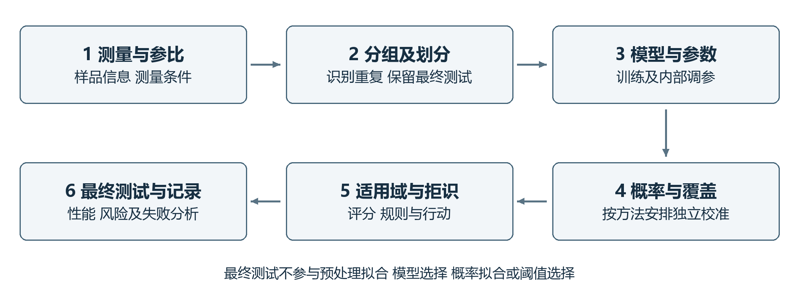
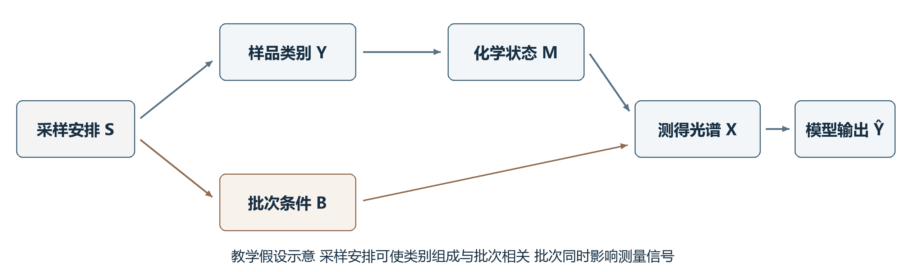
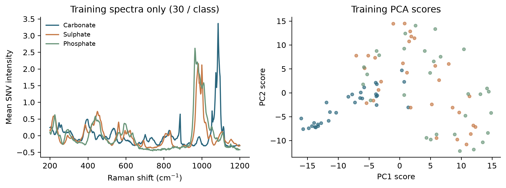
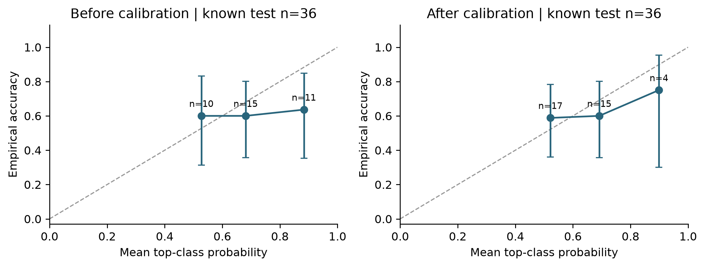
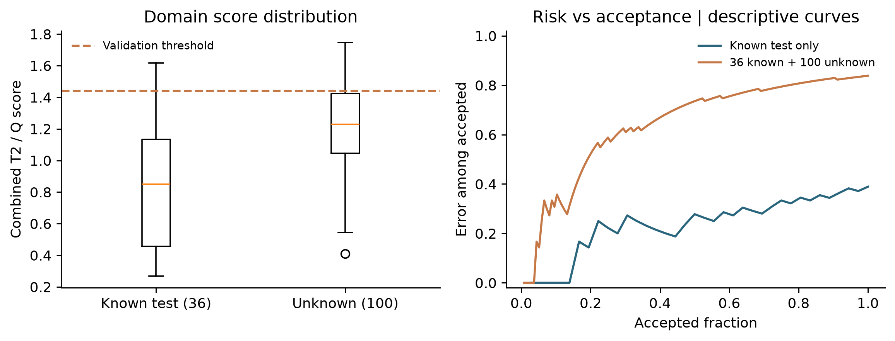
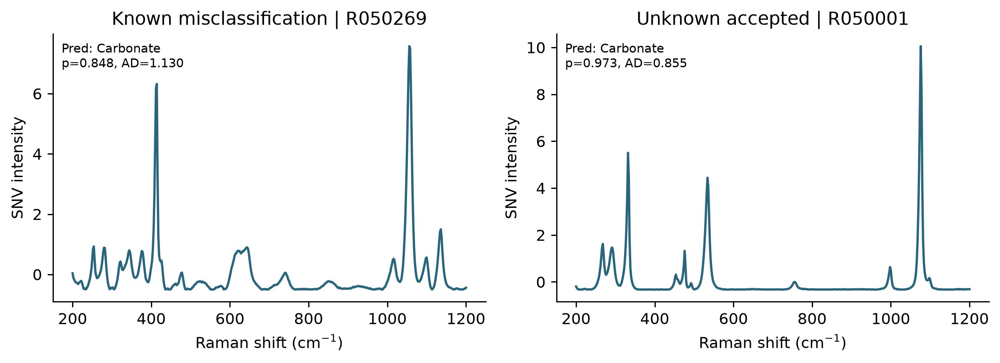

# 分析化学中的可信智能分析

不确定度 适用域与因果机制

刘翔 尹伟旭 王怡可 王磊 周裕东 曾凡琦

## 摘要

人工智能可用于光谱识别和化学性质预测，其可靠性还取决于数据质量、概率表达和使用范围。本文结合分析方法验证与机器学习研究，梳理不确定度、概率校准、共形预测、适用域和因果解释的条件，并实施公开拉曼谱库的可复核教学实验。先导标签审计发现来源分类与理想化学式冲突，随后排除全部340个先导编号，以新选280个编号构建明确的化学式基团规则任务。主实验在36个已知测试样品上准确率为61.1%；温度缩放保持类别判断不变，负对数似然从1.566降至1.295。预设T²与Q联合拒识规则接受34个已知测试样品，其中13个错误，同时接受100个留出未知材料中的81个。结果说明，概率质量改善与未知材料识别需分别检验，参考标签也需要接受化学核查。本文提供方法比较、逐样品结果、代码、练习及离线交互模块，形成可以追溯的数据与验证记录；证据范围限于该规则任务，尚无跨仪器外部验证。

关键词：智能分析化学；测量不确定度；概率校准；共形预测；适用域；因果推断

## 目录

- [摘要](#abstract)
- [一、引言](#section-1)
    - [1.1 智能分析的应用与可靠性问题](#section-1-1)
    - [1.2 可信智能分析的研究范围](#section-1-2)
- [二、智能分析预测的不确定度](#section-2)
    - [2.1 测量链与模型中的不确定度来源](#section-2-1)
    - [2.2 偶然不确定度与认知不确定度](#section-2-2)
    - [2.3 不同输出形式的统计含义](#section-2-3)
    - [2.4 不确定度传播与蒙特卡洛方法](#section-2-4)
- [三、概率校准与共形预测](#section-3)
    - [3.1 分类正确性与概率可靠性](#section-3-1)
    - [3.2 温度缩放与评价指标](#section-3-2)
    - [3.3 共形预测与边际覆盖](#section-3-3)
    - [3.4 依赖数据与覆盖边界](#section-3-4)
- [四、适用域检测与拒识策略](#section-4)
    - [4.1 分析模型的适用域](#section-4-1)
    - [4.2 得分距离与残差的互补检查](#section-4-2)
    - [4.3 现代检测评分与阈值选择](#section-4-3)
    - [4.4 接受率与选择性风险](#section-4-4)
- [五、混杂因素与解释的证据边界](#section-5)
    - [5.1 批次捷径与完全混杂](#section-5-1)
    - [5.2 数据划分与预处理泄漏](#section-5-2)
    - [5.3 干预与对照的作用](#section-5-3)
    - [5.4 归因稳定性与机制判断](#section-5-4)
- [六、物理化学约束与方法验证](#section-6)
    - [6.1 约束知识的使用条件](#section-6-1)
    - [6.2 机理与数据模型的结合](#section-6-2)
    - [6.3 分析性能与机器学习指标](#section-6-3)
    - [6.4 记录与变更后的再评价](#section-6-4)
- [七、拉曼分类实验与前沿讨论](#section-7)
    - [7.1 数据来源与标签审计](#section-7-1)
    - [7.2 建模与概率校准](#section-7-2)
    - [7.3 分类与拒识结果](#section-7-3)
    - [7.4 化学解释与前沿比较](#section-7-4)
- [八、结论与展望](#section-8)
- [参考文献](#references)

## 一、引言

### 1.1 智能分析的应用与可靠性问题

光谱等分析数据通常具有变量多、变量相关和重复测量层级复杂等特点。机器学习可以综合多个波段的信息，支持物质识别及性质预测。拉曼光谱细菌分类和微塑料自动光谱分析提供了具体应用实例，但它们涉及不同的样品、标签体系与分析终点，不能用同一个准确率数字概括可靠性。实际应用还取决于制样方式、仪器状态、谱库覆盖及新样品与建模样品的差异[1,2]。

当分析模型用于判断未知样品时，使用者需要知道预测依据是否充分、概率表达是否可信，以及在哪些条件下应复测或转交其他方法。某一测试集上的高准确率，不能单独回答这些问题。模型可能正确区分类别但持续高估概率，也可能在新分布上同时失去分类能力和概率可靠性[3,4]。 对分析化学而言，这些问题还应放回测量过程：被测对象、样品代表性、参考信息及测量条件共同决定结论能够支持到何种程度[5]。

### 1.2 可信智能分析的研究范围

本文将可信智能分析理解为：围绕明确的分析目的，对数据来源、测量与建模过程、预测不确定度、适用范围和解释依据进行相互衔接的验证与记录。这一界定侧重分析结论的可靠性，不将一般人工智能治理的全部议题纳入讨论。其基本要求是让性能数字对应具体数据和使用条件，使接受、拒识及补充测量的决定具有可检查的依据。

本文将文献综述、方法比较与公开拉曼数据教学实验结合，先讨论不确定度、概率表达和适用域，再分析混杂、解释与方法验证，最后报告标签审计和独立留出编号上的计算结果。图1给出证据组织顺序。实验针对理想化学式基团规则构成的分类任务，研究概率校准和拒识表现；定量检出限与完整化学机制验证需要另行设计实验。

图1 可信智能分析的验证流程。作者绘制的概念示意，评价步骤应对应同一分析用途；流程本身不构成性能保证。

## 二、智能分析预测的不确定度

### 2.1 测量链与模型中的不确定度来源

测量不确定度与测量结果相联系，用于表征可合理赋予被测量的量值分散程度[6]。 在智能分析中，其来源可以沿采样、制样、仪器测量、参考信息和模型处理逐步识别。例如，样品不均匀性影响所取部分的代表性，制样条件和仪器响应影响光谱，参考方法及标签记录影响训练目标，建模样品覆盖与模型设定影响预测。这里列举的是需要调查的误差来源，不能在缺少数据时直接为它们分配数值。

分类概率描述给定输入和模型下的类别输出，不是测量链全部不确定度的汇总。对固定光谱重复运行算法，只能考察计算或模型随机性；它不覆盖重新采样、重新制样及仪器长期变化。即使预测区间由模型给出，也需要说明其针对的是未来观测、模型均值还是其他对象。将这些对象混用，会造成区间含义与分析用途不一致[5,7]。

误差、偏倚和不确定度也应区别使用。已识别偏倚需要评估并在适当情况下校正，校正本身仍可能有不确定度；不确定度不是一项可以代替偏倚调查的附加量。对参考标签存在疑问的样品，模型与标签不一致也不能立即归因为模型失效，应回查参考方法和记录[5,6]。

### 2.2 偶然不确定度与认知不确定度

机器学习中常用偶然不确定度描述在给定观测条件下仍存在的数据变异，用认知不确定度描述有限知识、数据覆盖或模型设定带来的不足。这种区分需要结合模型与观测条件理解：提高仪器信噪比可能改变原先视为不可约的变异，增加训练数据也不必然消除错误模型结构带来的偏差。

深度集成以多个模型的预测组成集成，是表达模型差异的一种代表方法；预测一致不意味着样品处于适用域内，集成成员也可能共同依赖同一种捷径[8]。 Ovadia等在多个任务中比较了不确定度方法，发现数据偏移会影响误差和概率质量。该结果说明，不确定度表达还需要在目标条件下检验，不能仅凭方法名称判断可靠性[4]。

### 2.3 不同输出形式的统计含义

点预测便于直接作出类别或数值判断，但不呈现预测范围；概率向量表达模型对各候选类别的分配，预测集合允许保留多个候选标签，回归区间则在连续量尺度上表示可能范围。这些表达适用于不同问题，均需说明构造依据。分类集合很大时，即使覆盖率高，也可能缺少鉴别价值；区间很窄时，若经常遗漏真实结果，也不能称为可靠[9]。

表1比较本文使用的主要概念。特别需要区分机器学习的分类准确率与计量学中的准确度、正确度和精密度；仅将英文术语直接对应中文，容易掩盖评价对象的不同。

表1 可信分析中主要概念的评价对象

| 概念 | 评价对象 | 不能单独推出的结论 |
|---|---|---|
| 分类准确率 | 给定测试样本中类别判断的正确比例 | 概率可靠或跨条件有效 |
| 概率校准 | 预测概率与相应经验频率的一致性 | 每个样品正确或必然域内 |
| 预测覆盖 | 真实标签或数值是否落入集合或区间 | 集合足够小或逐样品保证 |
| 适用域 | 新输入与建模支持范围的关系 | 域内必对或域外必错 |
| 拒识接受率 | 全部输入中系统选择作答的比例 | 被接受预测必然可靠 |
| 测量精密度 | 规定条件下重复测量结果的一致程度 | 无偏或分类precision较高 |

### 2.4 不确定度传播与蒙特卡洛方法

对定量测量模型Y=f(X)，在适当线性近似下，输入估计量的协方差可经灵敏度系数传播到输出方差。记J为模型在输入估计值处的梯度行向量，Σ为输入协方差矩阵，合成标准不确定度的近似关系为式（1）。相关输入的协方差不能在没有依据时忽略[6]。

$$
u_c^2(y) \approx J\Sigma J^{T}. \tag{1}
$$

当非线性或分布形状使近似不充分时，可依据输入量的联合分布抽样，经测量模型计算输出，并概括输出分布。蒙特卡洛抽样增加的是数值传播能力，不会自动修正错误输入分布或遗漏的模型项[7]。 对光谱分类器实施噪声扰动可以作为局部敏感性检查，但若扰动只覆盖某一仪器噪声设定，其结果就不能称为完整测量链的不确定度评定。

## 三、概率校准与共形预测

### 3.1 分类正确性与概率可靠性

概率校准考察预测概率与相应事件发生频率是否一致。例如，在明确的数据条件下，被赋予约0.8最高类别概率的一组样品，其实际正确比例是否接近0.8。这里的0.8用于解释定义，不是本文实验结果。有限样本会产生频率波动，而且总体校准不能自动推出每个类别、批次或基质子群均同样校准[3]。

校准评价应同时保留分类结果和概率结果。可靠性图将分箱后的平均概率与平均正确率进行比较，还应给出每箱样本量。期望校准误差（expected calibration error，ECE）常按箱内差值加权汇总，但其大小会受分箱数、边界与样本量影响，不能脱离设置直接比较不同研究。对样本较少的子群，可靠性图的起伏也需要结合统计波动解释[3]。

### 3.2 温度缩放与评价指标

温度缩放对固定模型的未归一化类别得分（logits）采用共同正温度T，得到式（2）的概率。式中K为类别数，zₖ为第k类得分。T在训练之外的数据上拟合，最终测试数据不参与其选择。由于除以正数不改变logits的类别排序，该方法保持argmax及分类准确率不变；改变的是概率分配。这个结论不适用于任意类别特异变换或重新训练模型的情形[3]。

$$
p_T(k\mid x)=\frac{\exp(zₖ/T)}{\sum_{j=1}^{K}\exp(z_j/T)},\quad T>0. \tag{2}
$$

若以负对数似然（negative log-likelihood，NLL）评价真实标签得到的概率，概率极低的错误预测会受到较大惩罚。多分类Brier分数则累计各类别概率与独热标签的平方差。本文采用不额外除以类别数K的定义，如式（3）所示；其中pᵢₖ为样品i属于第k类的预测概率，指示函数在$y_i$=k时取1，否则取0；比较其他研究时应先核对归一化约定。这两项评价概率预测的整体质量，不能全部解释为纯校准误差[4]。

$$
\mathrm{BS}=\frac{1}{n}\sum_{i=1}^{n}\sum_{k=1}^{K}\left(p_{ik}-\mathbf{1}(y_i=k)\right)^2. \tag{3}
$$

校准前后的对照应使用同一最终测试边界，报告准确率、NLL、Brier分数和可靠性图。若模型在已有分布上概率得到改善，还需分别考察这种变化在新批次或扰动条件下是否保持。Ovadia等的研究表明，原分布上的校准不能直接作为偏移分布上的保证[4]。

### 3.3 共形预测与边际覆盖

共形预测使用校准数据确定分数阈值，再为新样品构造预测集合或区间。以一个简单分类方案为例，固定模型后，定义非一致性分数$s_i$=1−p($y_i$|$x_i$)，分数越大表示模型给真实类别的支持越弱。对于n个校准样本，在给定名义错误水平0＜α＜1下取第ceil((n+1)(1−α))阶分数为阈值q；若该秩为n+1，则依相应约定取无穷大，不能随意截断后仍宣称相同保证[9]。

新样品的预测集合及其边际覆盖结论可表示为式（4）。下界需要数据交换性等相应条件，通常可由独立同分布的标准设置满足；模型和分数函数的拟合方式也必须符合算法要求。概率校准并非该分数获得边际覆盖的必要前提，但分数质量影响集合是否具有实际用途[9]。

$$
C(x)=\{y:1-p(y\mid x)\le q\},\qquad \Pr\{Y\in C(X)\}\ge 1-\alpha. \tag{4}
$$

边际覆盖是关于校准样本与新样本随机性的总体陈述。它不是某一个给定样品有固定正确概率，也不自动保证每一类别和每一批次的条件覆盖。因此，经验评价应同时给出总体覆盖、分类别覆盖、集合大小及空集合和多标签集合比例；多标签集合说明尚不能唯一判别，不能直接计作与单标签误分类相同的事件[9]。

### 3.4 依赖数据与覆盖边界

重复采集、时间顺序与批次结构会使光谱数据偏离简单独立抽样情形。共形预测的扩展研究已讨论部分非交换过程，但额外保证需要额外条件。Oliveira等以校准经验分布的集中和测试分数的解耦等假设分析覆盖损失，并在平稳β混合等设置下进一步具体化。相关理论不能改写为对任意仪器漂移均保持精确覆盖[10]。

化学应用也应区分任务。Jovic将共形预测用于中红外食品掺假定量，Xu等研究定量构效关系（quantitative structure–activity relationship，QSAR）回归的共形方法；它们为化学领域的不确定度表达提供实例，却不直接证明特定光谱分类器在批次外推时有效[11,12]。 若真实类别不在既定候选标签空间，已知标签的预测集合也无法包含该未知标签，此时还需要另行定义未知类检测及其评价。

## 四、适用域检测与拒识策略

### 4.1 分析模型的适用域

适用域描述模型得到数据支持的范围，既包括特征空间结构，也涉及样品类型、基质、测量程序和目标任务。统计距离可以提供范围检查，但相同距离在不同表示空间中含义不同。异常样品、被误分类样品和域外样品之间也没有一一对应关系：域内存在分类错误，域外也可能偶然得到正确标签。

Hosni等在QSAR分类和回归中发现，显式适用域计算常能区分平均而言更可靠与较不可靠的预测及不确定度估计，但差异随数据与评价设置而变化[13]。 这支持同时检查预测概率与输入支持范围；它不意味着某一种分子结构相似性阈值可以直接用于光谱，也不意味着域内身份就是逐样品正确证明。

### 4.2 得分距离与残差的互补检查

马氏距离利用协方差描述变量尺度与相关性，高维小样本下需要处理协方差估计不稳定的问题。主成分分析（principal component analysis，PCA）将光谱映射到低维得分空间。将预处理并按训练参数中心化后的输入记为r，保留A个主成分的载荷矩阵为$P_A$，得分和残差如式（5）所示；相应特征值矩阵为$\Lambda_A$，T²和Q如式（6）所示[14]。

$$
t=P_A^{T}r,\qquad e=r-P_At. \tag{5}
$$

$$
T^2=t^{T}\Lambda_A^{-1}t,\qquad Q=e^{T}e. \tag{6}
$$

T²考察保留子空间内的标准化得分距离，Q考察该子空间未解释的重构残差。因此，沿已有变化方向远离中心与出现新的信号结构，可能产生不同的评分组合。Jackson与Mudholkar对残差控制的讨论为这种区分提供原始依据；其控制限涉及分布和协方差条件，不能直接照用于所有小样本光谱[14]。 在实际流程中，标准化、PCA维数与阈值均应由最终测试之外的数据确定。

### 4.3 现代检测评分与阈值选择

最大类别概率可作为简单检测基线，特征空间马氏评分和能量评分则利用模型内部表示或输出构造指标[15,16,17]。 不同方法的评分方向、训练需求及参数不同，比较时需要固定评价任务。神经网络中的能量评分不是化学体系能量；一般距离或能量值也不自动等于错误概率。

阈值选择应与行动对应。若错误接受的代价较高，可以提高拒识程度，但应同时记录被拒绝的正常样品和复测负担。对未知类别检测，应明确哪些标签被留作未知类、是否在训练与阈值选择中出现过，并报告域外接受和域内误拒。仅在已知类别上调整阈值后提高保留部分的准确率，不足以证明未知类检测有效。

### 4.4 接受率与选择性风险

选择性分类由预测器f和接受函数g共同组成，g取1表示接受，取0表示拒识。式（7）给出测试集接受率φ及接受部分的经验错误率R。拒识接受率与共形覆盖概率具有不同分母和事件含义；它也不等于某类别召回率[18]。

$$
\widehat{\phi}=\frac{1}{m}\sum_{i=1}^{m}g_i,\qquad \widehat{R}=\frac{\sum_i g_i\mathbf{1}(\widehat{y}_i\ne y_i)}{\sum_i g_i}. \tag{7}
$$

全部样品被拒识时，错误率分母为零，应记为不适用。风险—接受率曲线可以显示接受规模与错误风险之间的取舍，但不能把某条曲线看起来较低直接转化为严格风险保证。Geifman与El-Yaniv的风险控制依赖特定算法和抽样条件，不能由任意阈值滑块自动继承[18]。 对分析流程而言，拒识后的复测、补充参比测量与记录同样属于方法的一部分。

表2 核心方法的选择依据

| 方法 | 主要作用 | 数据条件 | 评价重点 |
|---|---|---|---|
| 温度缩放 | 调整固定分类器概率 | 模型固定 专用校准数据 | NLL Brier与可靠性图 |
| 共形预测 | 构造预测集合或区间 | 交换性或相应扩展条件 | 覆盖率与集合大小 |
| T²与Q | 检查得分距离及重构残差 | 训练表示 维数与阈值固定 | 已知误拒及未知接受 |
| 拒识规则 | 决定接受或转交复测 | 阈值及行动用途明确 | 接受率与条件错误率 |

表2按目标组织方法选择：已知类别的概率表达可先用温度缩放评价；需要集合输出时，应按数据条件选择共形算法；新输入的支持范围可由适用域评分辅助检查。拒识是建立在评分和阈值之上的行动规则，可与前述方法组合。本文计算案例采用温度缩放与T²/Q基线，共形与因果方法保留为理论比较，未将其写成已经实现的实验。

## 五、混杂因素与解释的证据边界

### 5.1 批次捷径与完全混杂

假设A类样品仅在某一天由一台仪器采集，B类样品仅在另一天采集。模型可能利用背景、基线或仪器响应识别批次，而不是利用目标化学差异。把这些光谱随机分到训练和测试部分，仍可能在两部分保留相同的类别与批次关联。这个教学情境用于说明混杂风险，不对应本文已观测的数据。

图2将化学信号路径与采样安排形成的批次关联分开表示。若类别与批次完全绑定，仅靠原数据的统计调整通常难以辨别两个来源；需要增加跨批次的同类样品、同批次的不同类别或其他能够打破绑定的数据。因果分析因此首先要求说明数据是怎样产生的[19,20]。

图2 批次混杂的教学因果图。S表示使类别组成与批次同时变化的采样安排，Y为类别，M为与类别相关的化学状态，B为批次或仪器条件，X为光谱。箭头表示假设的生成关系；该图不表示批次能够改变样品原有类别，也不是本组数据的已识别因果结构。

### 5.2 数据划分与预处理泄漏

重复光谱的数量不等于独立样品数量。若同一颗粒、细胞、试样或图像的重复信息同时出现在训练和测试部分，测试就可能过于接近模型已经见过的对象。Guo等拉曼分析协议的公开扩展材料展示了采集层级，Lilek等的摘要和补充说明则提示，不同数据中的组可能分别指测量重复或生物重复[21,22]。 因此，分组单位应由实际采集结构和未来使用对象确定，不能只按文件名或光谱行号划分。

预处理和模型选择也可能泄漏。利用全体数据拟合标准化、PCA、特征选择或超参数，都会使最终测试信息进入开发过程[20]。 依赖数据的验证应围绕未来要预测的新对象设计：新试样、新批次和新仪器对应不同的外推问题[23]。 分组验证得到较低性能，可能说明任务更接近真实外推，而不是算法质量必然下降；仍需先确认两种验证设置回答的是何种问题。

### 5.3 干预与对照的作用

相关关系描述共同变化，干预则要求在明确假设下改变特定因素并观察后果。模型对某个波段敏感，并不等于改变相应化学成分就会产生同样的预测变化，因为波段还可能与背景和处理方式相关[19]。 对光谱分类，可设计同一样品跨日期或跨仪器测量、同批次加入不同类别、改变基质但保持目标组分等对照，以区分化学信息和条件捷径。

对照方案需要遵守实际化学过程。若人为删去波段或独立扰乱每个变量，可能形成物理上不存在的光谱；其作用更接近模型压力测试。解释此类结果时，应说明扰动能否对应真实仪器或样品变化，避免把计算干预直接当作化学实验干预。

### 5.4 归因稳定性与机制判断

线性系数、PCA载荷和基于Shapley值的特征归因方法（SHapley Additive exPlanations，SHAP）等方法可以帮助描述模型对特征的依赖，但解释对象与尺度不同。SHAP在特定加性解释框架中分配特征贡献；对高度相关的波数，贡献分配还涉及特征依赖与背景选择[24]。 显著图随机化检查提醒使用者，图形清晰并不足以说明解释反映了所学模型[25]。

Yeh等分别定义解释的不忠实度和敏感性，指出恒定解释也可极稳定[26]。 因而，光谱归因需要同时检查解释对合理扰动的稳定程度，以及归因能否反映模型输出变化。通过这些检验仍主要说明模型层面的解释质量，化学机制还需要峰归属、参比样品、独立仪器或其他实验结果支持。

注意力解释研究也不能被概括成单一口号。Jain与Wallace在RNN文本任务中给出注意力与其他重要性指标不一致等证据；Wiegreffe与Pinter则质疑部分检验前提，提出结合整体模型、随机种子和基线的诊断方式[27,28]。 将其用于分析化学时，合理结论是注意力权重需要针对具体模型验证；上述NLP研究不能直接决定所有光谱注意力模型是否具有解释价值。

## 六、物理化学约束与方法验证

### 6.1 约束知识的使用条件

物理化学知识可以约束输入、模型结构或输出。例如，特定测量条件下的守恒关系可限定组分解释，非负性可约束有相应物理含义的浓度，仪器响应关系可参与定量建模。约束的价值在于利用与任务有关的信息，但约束是否成立必须先于模型性能讨论[29]。

光谱预处理后的变量不一定保持原始物理含义：基线校正后出现负值不应一律判为物理错误，吸光度与浓度的简化关系也有测量条件和范围限制。把非负或单调关系强加到不满足条件的数据，可能产生新的偏差。因此，应写清约束施加在原始测量量、潜变量还是预测输出上，以及违反约束时如何调查。

### 6.2 机理与数据模型的结合

机理和数据模型可以通过固定结构、参数约束、残差建模或损失函数结合。物理信息神经网络是将特定方程关系纳入训练的一类代表方法；其原始研究针对偏微分方程正逆问题，不能仅凭这一名称证明其适合所有光谱分类任务[29,30]。 对规模有限的分类作业，先采用可诊断基线和清楚的验证设计，往往更有助于定位问题来源。

### 6.3 分析性能与机器学习指标

Eurachem方法验证指南强调根据用途制定验证计划，评价选择性、偏倚、精密度、不确定度等性能[5]。 智能分析可借用这一组织原则，但应分别定义计量学术语和分类指标。分类precision的中文常译“精确率”，其分母是预测阳性样本数；测量精密度关注规定条件下重复结果的分散，二者并非同一性质。

定量方法的线性范围、检出限和定量限，也不能由分类准确率推导。若论文只实施分类案例，可以讨论这些验证问题与可信分析的关系，但应将实际证据限定在分类、概率质量和拒识表现。分析方法的稳健性还涉及合理的小幅条件变化，重复运行同一代码不等于完成这一验证[5]。

### 6.4 记录与变更后的再评价

可复核报告应交代数据版本、排除规则、划分单位、预处理、模型参数、软件依赖和评价方式。REFORMS提供机器学习科学研究的报告建议，有助于检查这些材料是否足以复核，但报告齐全不能代替数据质量和外部验证[31]。 更换仪器、谱库或预处理规则后，应检查原校准与拒识阈值是否仍适用；方法变更产生的新结论，应有相应的新证据。

## 七、拉曼分类实验与前沿讨论

### 7.1 数据来源与标签审计

数据来自Celestian于Zenodo发布的RamanLab整理库v1，原始来源包含RRUFF等谱库；本文仅使用带RRUFF编号和链接的记录。整理库API声明CC BY 4.0，本文保留整理者和RRUFF署名、版本、源文件散列及逐谱来源。源文件扩展名为.sqlite，实际内容为数据字典序列化；读取程序禁止加载可执行类[32,33]。

先导实验发现HEY CLASSIFICATION分类与化学式冲突。例如Gaspéite编号R040157的理想化学式为NiCO₃，却被整理字段归为Oxides and Hydroxides；CSIRO材料库将Gaspéite列为含CO₃材料及碳酸盐[34]。 因而模型预测“Carbonates”与该字段不一致，应先调查标签，不能直接认定为已经证实的化学识别错误。该冲突定位于所下载整理文件，不据此认定原RRUFF谱库的全部分类均有同样问题。

为避免看过测试结果后修补标签并在同一数据上宣称进步，确认实验排除先导过程中接触过的全部340个RRUFF编号，重新确定有限教学任务。标签由来源理想化学式字符串规则生成：解码格式标记后检查CO3、SO4、PO4、AsO4，大小写敏感，仅命中其中一个且属于前三者的记录依次标为碳酸根、硫酸根、磷酸根规则类。未知材料含Si且含O，同时不含上述四个目标基团。该未知组包含SiO₂等材料，因此不统称为硅酸盐。化学式参与标签构造，不作为模型特征；这套规则也不替代全面矿物学鉴定或样品纯度核验。

数据固定为532 nm、已处理、非定向且覆盖200–1200 cm⁻¹的谱。以R加六位数字为保守分组键，每个编号取排序后第一条合格记录；线性插值至间隔2 cm⁻¹的501点，排除非有限、常数及完全相同的插值谱。三个已知规则类各60个新编号，未知组100个，共280个。编号重复和完全重复信号均为0，先导交集为0；编号隔离仍不足以证明按矿物种、产地或仪器批次隔离。图3呈现训练谱均值和主成分得分。

图3 训练数据的逐谱SNV均值和PCA得分。每个已知规则类30个训练编号；PCA仅在训练数据拟合。展示的是训练结构，未据图挑选最终测试样品。

### 7.2 建模与概率校准

预设主种子为2026102901，各已知类分别分配30/10/8/12个编号进入训练、概率校准、阈值验证和最终测试，表3列出总数。所有角色互斥，未知组不参与任何拟合或阈值选择。逐谱标准正态变量变换（standard normal variate，SNV）只使用该谱自身的均值和样本标准差；PCA的中心与载荷在训练中估计。

表3 主实验数据角色

| 数据角色 | 编号数 | 使用范围 |
|---|---|---|
| 训练 | 90 | 四折交叉验证及最终模型拟合 |
| 概率校准 | 30 | 拟合一个共同正温度 |
| 阈值验证 | 24 | 确定拒识经验分位数 |
| 已知最终测试 | 36 | 分类 概率及已知拒识评价 |
| 留出未知材料 | 100 | 仅评价未知材料接受情况 |

训练内部四折分层交叉验证比较PCA维数5、10、20及逻辑回归C=0.1、1、10，每折重新拟合PCA，以平均NLL选出10个主成分和C=0.1。最终模型只在90个训练编号上拟合；专用校准集拟合共同正温度T=1.451，优化范围为log(T)∈[−4,4]。全体样品校准前后argmax一致。

主适用域评分取两个归一化分数的较大值：T²除以训练T²的95%经验分位数，Q除以训练Q的95%经验分位数。拒识阈值在24个阈值验证编号上按90%经验分位数的higher约定固定为1.441，超过阈值拒识。该经验设置只表达预设操作点，不提供90%未知检出保证。附加基线采用1−最大校准概率评分，并在同一专用阈值集确定阈值。

### 7.3 分类与拒识结果

已知测试36个编号中22个分类正确，准确率61.1%，Wilson 95%区间44.9%–75.2%，宏F1为0.592。表4在同一测试集比较概率指标。校准后NLL、Brier和5等宽箱ECE均较低，准确率保持不变。配对自助法2000次得到NLL差（校准后减校准前）−0.272，95%百分位区间[−0.636,−0.004]；该区间仅描述本次有限测试编号的重采样波动，不包括划分、仪器和标签不确定度。

表4 已知最终测试的概率评价

| 指标 | 校准前 | 校准后 |
|---|---|---|
| 准确率 | 22/36 61.1% | 22/36 61.1% |
| 宏F1 | 0.592 | 0.592 |
| NLL | 1.566 | 1.295 |
| Brier 不除类别数 | 0.547 | 0.540 |
| ECE 5等宽箱 | 0.129 | 0.086 |

图4 已知测试集可靠性图。5个等宽箱中空箱不画点，标注非空箱编号数，误差条为箱内正确率Wilson 95%区间。每箱规模很小，图形与ECE应结合样本量解释。

表5显示主T²/Q规则接受34/36个已知测试编号，其中13个错误，接受部分错误率38.2%；未拒识时错误率为14/36=38.9%，拒识带来的变化很有限。该规则还接受81/100个未知材料，未知接受率Wilson 95%区间72.2%–87.5%。尽管区分未知的AUROC为0.780，预设操作点仍漏过大量未知，说明排序指标与实际阈值效果应分别报告。最大概率基线接受95个未知，两个评分均未达到可依赖的未知拒识能力。

表5 预设阈值的拒识结果

| 评价项 | T²/Q主规则 | 最大概率参照 |
|---|---|---|
| 已知接受 | 34/36 94.4% | 34/36 94.4% |
| 接受已知中的错误 | 13/34 38.2% | 13/34 38.2% |
| 未知接受 | 81/100 81.0% | 95/100 95.0% |
| 未知为正类AUROC | 0.780 | 0.506 |

图5 适用域评分及风险—接受率曲线。虚线阈值仅来自已知阈值验证集。混合曲线使用36个已知和100个未知的人工组成，将未知被迫赋为已知类别计作错误；它不代表实际部署中的未知比例或总体风险。

五个预设种子的同池划分敏感性检查中，准确率范围61.1%–77.8%，未知接受率52.0%–85.0%；两次划分的校准后NLL反而增大。全部种子结果随代码保存，未用最好一轮替换主结果。这些重复共享数据池，并非五次独立采集实验，也不应据此计算跨实验室稳定性。

### 7.4 化学解释与前沿比较

确认实验中有14个已知错误，其中1个校准后最高概率≥0.8。图6示出概率最高的已知错误R050269和被接受未知中概率最高的R050001。逐谱结果保存了真实规则类、预测类、概率、T²、Q及接受标记，可追溯到来源理想化学式与谱记录。类别的振动基团可能具有相近峰区，多组分取代、参考谱处理及仅保留10个主成分也可能影响区分；本实验没有开展波段干预或独立结构鉴定，故这些是待检验解释，不将载荷、峰形或分类相关性写成已证实的机制。

图6 预设主实验的真实失败样品。左为已知规则类误分，右为留出未知材料被接受；标题给出RRUFF编号、预测最高概率与适用域评分。样品从对应失败组按最高校准概率确定，用于诊断，未据其结果重新拟合模型。

文献中的分析化学应用提供了更完整的使用情境。Cowger等的OpenSpecy流程将微塑料图像和光谱处理、谱库匹配、颗粒测量及报告串联。其公开接受稿比较了15种配置、22幅图像中的2880个颗粒，提示数据处理和阈值应在具体颗粒与测量情境下验证[2]。 谱库匹配相关系数应与参考鉴定结果、未匹配颗粒及处理规则一起解释，不能直接当作本实验的校准概率；该研究的验证对象也不同于此处的单条参考拉曼谱。

表6概括理论、化学预测及实际采集层级的近期进展。共形预测回答集合覆盖，适用域研究关注训练支持，生物光谱验证研究关注采集层级。本文结果进一步说明，三个层面之前还需检查参比标签是否与化学定义一致。

表6 近期研究的贡献与应用边界

| 研究 | 研究对象与贡献 | 对本文的启示与限制 |
|---|---|---|
| Oliveira等 2024 | 非交换数据的split conformal覆盖分析 | 检查依赖条件及覆盖损失 |
| Xu等 2024 | QSAR回归共形方法评价 | 同时报告有效性与区间效率 |
| Jovic 2025 | 中红外食品掺假定量的共形预测 | 化学实例 原数据不允许共享 |
| Lilek等 2025 | 生物光谱验证策略比较 | 组单位依赖实际采集层级 |
| Cowger等 2025 | 微塑料自动光谱分析流程 | 阈值与样品及处理情境相连 |
| Hosni等 2026 | QSAR适用域与不确定度可靠性 | 二者互补 指标需按任务验证 |

表6的文献分别见相关原始来源[2,10,11,12,13,22]。 对Lilek等仅使用已取得的公开摘要和补充说明，不外推未核对的参数与数值；Jovic数据未作为本组复现源。本文提供带版本的选谱数据、预设方案、代码、逐谱输出和交互页面；交互只在固定测试输出上重算指标，滑块探索不会获得新的独立验证证据。

## 八、结论与展望

可信智能分析需要将预测结果与分析用途、数据支持和测量条件相联系。不确定度表征说明变化来源与表达对象，概率校准检查概率与频率是否相符，适用域与拒识处理输入支持不足时的行动，因果与对照研究则为化学机制判断提供进一步证据。各环节相互补充，单项性能或单一方法名称均不足以涵盖全部要求。

本文的拉曼规则分类实验将上述要求落实为标签审计、编号隔离、独立校准和固定阈值。主实验中概率质量有所改善，但分类能力有限，未知材料仍被大量接受；同池划分也呈现明显波动。先导阶段发现的化学式与整理标签冲突表明，可信性需要同时追问预测依据和参比依据。后续研究可增加跨矿物种与跨仪器留出、取得重新测量及样品纯度证据，再评价适用域和化学解释。现有结果支持可复核教学与方法比较，不足以支持自动矿物鉴定的实际部署。

## 参考文献

[1] HO C S, JEAN N, HOGAN C A, et al. Rapid identification of pathogenic bacteria using Raman spectroscopy and deep learning[J]. Nature Communications, 2019, 10(1): 4927. [原始来源](https://doi.org/10.1038/s41467-019-12898-9)

[2] COWGER W, KARAPETROVA A, LINCOLN C, et al. Open Specy 1.0: Automated (Hyper)spectroscopy for Microplastics[J]. Analytical Chemistry, 2025, 97(32): 17345-17356. [原始来源](https://doi.org/10.1021/acs.analchem.5c00962)

[3] GUO C, PLEISS G, SUN Y, et al. On Calibration of Modern Neural Networks[C]. Proceedings of the 34th International Conference on Machine Learning, 2017, 70: 1321-1330. [原始来源](https://proceedings.mlr.press/v70/guo17a.html)

[4] OVADIA Y, FERTIG E, REN J, et al. Can You Trust Your Model’s Uncertainty? Evaluating Predictive Uncertainty Under Dataset Shift[C]. Advances in Neural Information Processing Systems, 2019, 32. [原始来源](https://papers.neurips.cc/paper_files/paper/2019/hash/8558cb408c1d76621371888657d2eb1d-Abstract.html)

[5] CANTWELL H (ed.). The Fitness for Purpose of Analytical Methods: A Laboratory Guide to Method Validation and Related Topics[R]. Eurachem Guide, 3rd ed., 2025. [原始来源](https://www.eurachem.org/index.php/publications/guides/mv)

[6] Joint Committee for Guides in Metrology. Evaluation of measurement data — Guide to the expression of uncertainty in measurement[R]. JCGM 100:2008, 2008. [原始来源](https://doi.org/10.59161/JCGM100-2008E)

[7] Joint Committee for Guides in Metrology. Evaluation of measurement data — Supplement 1 to the Guide to the expression of uncertainty in measurement — Propagation of distributions using a Monte Carlo method[R]. JCGM 101:2008, 2008. [原始来源](https://doi.org/10.59161/JCGM101-2008)

[8] LAKSHMINARAYANAN B, PRITZEL A, BLUNDELL C. Simple and Scalable Predictive Uncertainty Estimation using Deep Ensembles[C]. Advances in Neural Information Processing Systems, 2017, 30. [原始来源](https://proceedings.neurips.cc/paper/2017/hash/9ef2ed4b7fd2c810847ffa5fa85bce38-Abstract.html)

[9] ANGELOPOULOS A N, BATES S. A Gentle Introduction to Conformal Prediction and Distribution-Free Uncertainty Quantification[EB/OL]. arXiv:2107.07511, 2022. Public draft v6 submitted 2022-12-07; manuscript dated 2022-12-08. [原始来源](https://arxiv.org/abs/2107.07511v6)

[10] OLIVEIRA R I, ORENSTEIN P, RAMOS T, et al. Split Conformal Prediction and Non-Exchangeable Data[J]. Journal of Machine Learning Research, 2024, 25(225): 1-38. [原始来源](https://www.jmlr.org/papers/v25/23-1553.html)

[11] JOVIC O. Conformal predictors in chemometric study of mid-infrared food adulteration: quantification of prediction uncertainty[J]. Food Chemistry, 2025, 492(Part 1): 145387. [原始来源](https://doi.org/10.1016/j.foodchem.2025.145387)

[12] XU Y, LIAW A, SHERIDAN R P, et al. Development and Evaluation of Conformal Prediction Methods for Quantitative Structure–Activity Relationship[J]. ACS Omega, 2024, 9(27): 29478-29490. [原始来源](https://doi.org/10.1021/acsomega.4c02017)

[13] HOSNI Z, GILLET V J, MARCHESE ROBINSON R L. Explicit Applicability Domain Calculations Can Help Determine When Uncertainty Estimates Are Less Reliable[J]. ACS Omega, 2026, 11(3): 4722-4743. [原始来源](https://doi.org/10.1021/acsomega.5c11875)

[14] JACKSON J E, MUDHOLKAR G S. Control Procedures for Residuals Associated With Principal Component Analysis[J]. Technometrics, 1979, 21(3): 341-349. [原始来源](https://doi.org/10.1080/00401706.1979.10489779)

[15] HENDRYCKS D, GIMPEL K. A Baseline for Detecting Misclassified and Out-of-Distribution Examples in Neural Networks[C]. International Conference on Learning Representations, 2017. [原始来源](https://arxiv.org/abs/1610.02136)

[16] LEE K, LEE K, LEE H, et al. A Simple Unified Framework for Detecting Out-of-Distribution Samples and Adversarial Attacks[C]. Advances in Neural Information Processing Systems, 2018, 31. [原始来源](https://proceedings.neurips.cc/paper_files/paper/2018/hash/abdeb6f575ac5c6676b747bca8d09cc2-Abstract.html)

[17] LIU W, WANG X, OWENS J D, et al. Energy-based Out-of-distribution Detection[C]. Advances in Neural Information Processing Systems, 2020, 33. [原始来源](https://proceedings.neurips.cc/paper/2020/hash/f5496252609c43eb8a3d147ab9b9c006-Abstract.html)

[18] GEIFMAN Y, EL-YANIV R. Selective Classification for Deep Neural Networks[C]. Advances in Neural Information Processing Systems, 2017, 30. [原始来源](https://proceedings.neurips.cc/paper_files/paper/2017/file/4a8423d5e91fda00bb7e46540e2b0cf1-Paper.pdf)

[19] PEARL J. Causality: Models, Reasoning, and Inference[M]. Cambridge University Press, 2nd ed., 2009. [原始来源](https://doi.org/10.1017/CBO9780511803161)

[20] KAPOOR S, NARAYANAN A. Leakage and the reproducibility crisis in machine-learning-based science[J]. Patterns, 2023, 4(9): 100804. [原始来源](https://doi.org/10.1016/j.patter.2023.100804)

[21] GUO S, POPP J, BOCKLITZ T. Chemometric analysis in Raman spectroscopy from experimental design to machine learning–based modeling[J]. Nature Protocols, 2021, 16: 5426-5459. [原始来源](https://doi.org/10.1038/s41596-021-00620-3)

[22] LILEK D, ZIMMERMANN D, STEININGER L, et al. Machine Learning of Raman Spectroscopic Data: Comparison of Different Validation Strategies[J]. Journal of Raman Spectroscopy, 2025, 56(9): 867-877. [原始来源](https://doi.org/10.1002/jrs.6842)

[23] ROBERTS D R, BAHN V, CIUTI S, et al. Cross‐validation strategies for data with temporal, spatial, hierarchical, or phylogenetic structure[J]. Ecography, 2017, 40(8): 913-929. [原始来源](https://doi.org/10.1111/ecog.02881)

[24] LUNDBERG S M, LEE S I. A Unified Approach to Interpreting Model Predictions[C]. Advances in Neural Information Processing Systems, 2017, 30. [原始来源](https://proceedings.neurips.cc/paper_files/paper/2017/hash/8a20a8621978632d76c43dfd28b67767-Abstract.html)

[25] ADEBAYO J, GILMER J, MUELLY M, et al. Sanity Checks for Saliency Maps[C]. Advances in Neural Information Processing Systems, 2018, 31. [原始来源](https://proceedings.neurips.cc/paper/2018/hash/294a8ed24b1ad22ec2e7efea049b8737-Abstract.html)

[26] YEH C K, HSIEH C Y, SUGGALA A S, et al. On the (In)fidelity and Sensitivity of Explanations[C]. Advances in Neural Information Processing Systems, 2019, 32. [原始来源](https://proceedings.neurips.cc/paper/2019/file/a7471fdc77b3435276507cc8f2dc2569-Paper.pdf)

[27] JAIN S, WALLACE B C. Attention is not Explanation[C]. Proceedings of NAACL-HLT 2019, Volume 1 (Long and Short Papers), 2019: 3543-3556. [原始来源](https://doi.org/10.18653/v1/N19-1357)

[28] WIEGREFFE S, PINTER Y. Attention is not not Explanation[C]. Proceedings of EMNLP-IJCNLP 2019, 2019: 11-20. [原始来源](https://doi.org/10.18653/v1/D19-1002)

[29] KARNIADAKIS G E, KEVREKIDIS I G, LU L, et al. Physics-informed machine learning[J]. Nature Reviews Physics, 2021, 3(6): 422-440. [原始来源](https://doi.org/10.1038/s42254-021-00314-5)

[30] RAISSI M, PERDIKARIS P, KARNIADAKIS G E. Physics-informed neural networks: A deep learning framework for solving forward and inverse problems involving nonlinear partial differential equations[J]. Journal of Computational Physics, 2019, 378: 686-707. [原始来源](https://doi.org/10.1016/j.jcp.2018.10.045)

[31] KAPOOR S, CANTRELL E M, PENG K, et al. REFORMS: Consensus-based Recommendations for Machine-learning-based Science[J]. Science Advances, 2024, 10(18): eadk3452. [原始来源](https://doi.org/10.1126/sciadv.adk3452)

[32] CELESTIAN A. Raman Databases for RamanLab software (v1)[D]. Zenodo, 2025. [2026-10-29]. [原始来源](https://doi.org/10.5281/zenodo.15717961)

[33] LAFUENTE B, DOWNS R T, YANG H, et al. The power of databases: The RRUFF project[M]// Highlights in Mineralogical Crystallography. Walter de Gruyter, 2016: 1-29. [原始来源](https://doi.org/10.1515/9783110417104-003)

[34] CSIRO. Gaspéite: CSIRO Spectroscopy Database[EB/OL]. CSIRO, [n.d.]. [2026-10-29]. [原始来源](https://spectroscopy.csiro.au/material/Gasp%C3%A9ite)
